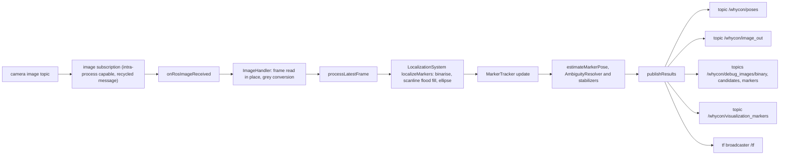
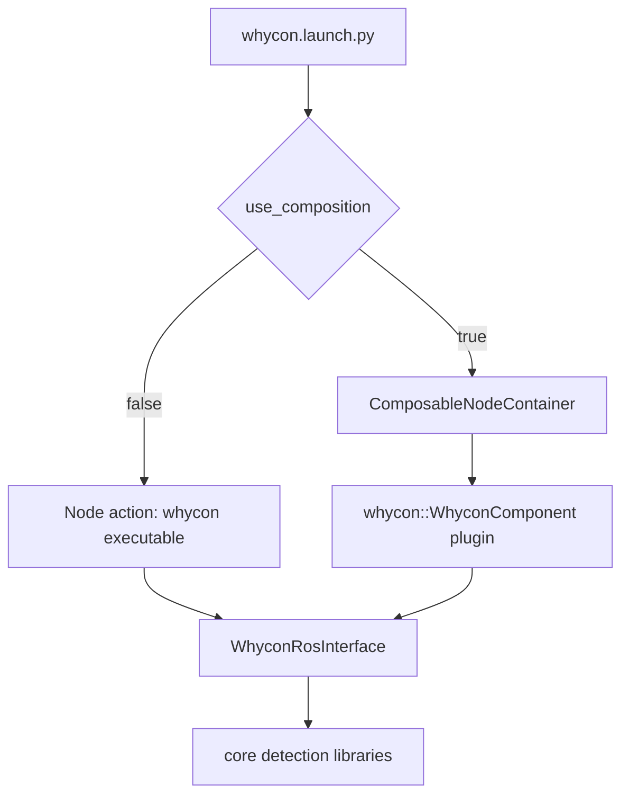
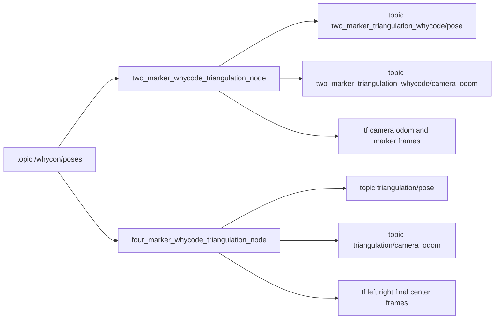

# Architecture

This document describes the internal architecture of `whycode_vision`, including runtime data flow, ROS2 composition, and triangulation integration.

## Runtime Architecture

`whycode_vision` has three major runtime layers:

1. ROS2 interface layer: parameter loading, the image subscription, services, and publications.
2. Core detection layer: image preprocessing, marker detection, WhyCode decoding, tracking, pose estimation.
3. Output layer: pose arrays, debug images, TF, and visualization markers.

Each frame is processed in the image callback, as it arrives:

The annotated image, the RViz markers and each debug panel are only built while something
subscribes to them. The detectors draw the binary and candidates panels as they search, and the
pose estimation draws a tile per marker on the markers panel; with no panel wanted, the detection
path passes no debug state at all.

## Component and Standalone Modes

The ROS1 nodelet path has been replaced with ROS2 components. As with nodelets, the gain comes
from sharing a process with the camera driver: the image subscription accepts intra-process
messages, so a driver loaded into the same container with intra-process communication hands its
frames over as pointers instead of through DDS.

- Standalone executable: `whycon`
- Composable component: `whycon::WhyconComponent`

## Triangulation Architecture

Triangulation nodes are separate ROS2 nodes that consume `/whycon/poses` and publish higher-level camera/marker geometry outputs.

## Ownership by File Group

- `src/ros/*`: ROS2 interface glue, composition support, runtime orchestration.
- `src/image/*`: image memory layout, grayscale conversion, packed binary representation.
- `src/core/*`: candidate detection, WhyCode decoding, pose math.
- `src/tracking/*`: temporal data association and stabilization.
- `src/triangulate/*`: 2-marker and 4-marker geometric triangulation nodes.
- `src/utils/*`: YAML config loading and global config access, and the values derived at startup from
  the camera (`CameraScaling`) and the marker (`MarkerGeometry`) for `auto` keys.
- `src/benchmarks/*`: benchmarks and self-checks of the hot kernels (built with `BUILD_BENCHMARKS`).
